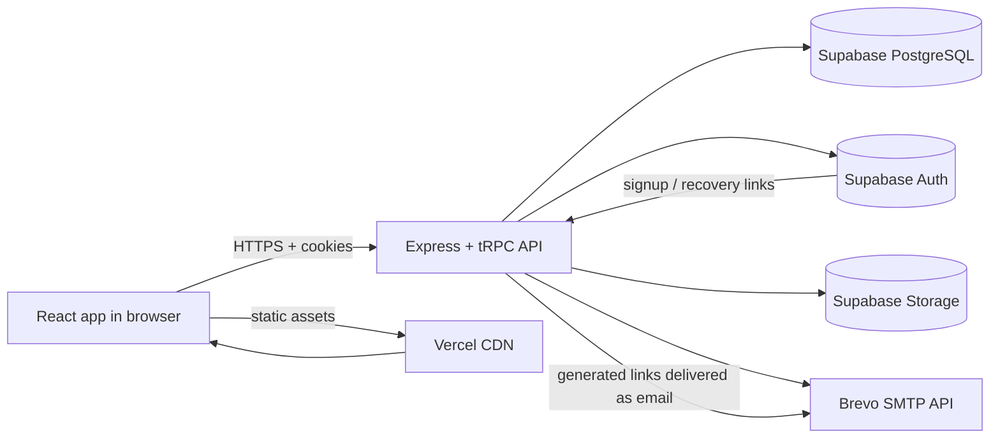
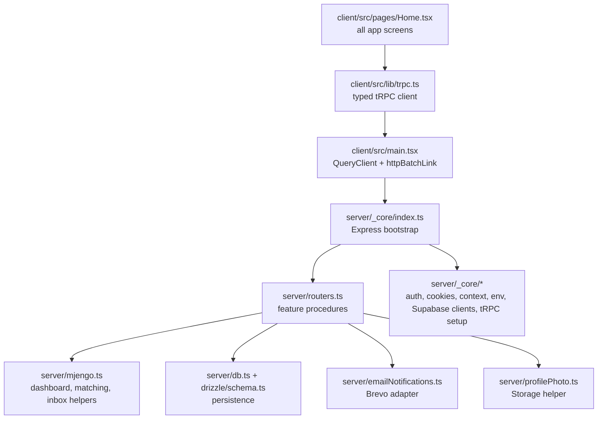

# Architecture

## Runtime topology

MjengoLink can run in two deployment shapes from the same repository:

1. **Full-stack server** — Express serves the tRPC API and the built React app. This is what `pnpm build && pnpm start` and the Render service do.
2. **Split deployment** — Vercel serves the static React build and Render serves the API. This is the current production-oriented configuration documented in `vercel.json` and `render.yaml`.



The browser never talks directly to application tables. All protected data goes through tRPC procedures that run on the server with server-held credentials.

## Technology stack

| Layer | Technology | Where |
|---|---|---|
| UI | React 19, Vite 7, Wouter, Sonner, Lucide | `client/` |
| Data fetching | TanStack Query 5, tRPC 11, Superjson | `client/src/main.tsx`, `client/src/lib/trpc.ts` |
| Styling | Tailwind CSS 4 with a single bespoke global stylesheet | `client/src/index.css` |
| API | Express 4, tRPC 11, Zod 4 | `server/_core/index.ts`, `server/routers.ts` |
| Authentication | Supabase Auth with HTTP-only cookies | `server/_core/auth.ts`, `server/_core/supabase.ts` |
| Persistence | PostgreSQL via Drizzle ORM and `postgres-js` | `server/db.ts`, `drizzle/schema.ts` |
| Email | Brevo SMTP API | `server/emailNotifications.ts` |
| File storage | Private Supabase Storage bucket | `server/profilePhoto.ts` |
| Tests | Vitest 2 | `server/**/*.test.ts` |
| Hosting | Render API, Vercel static frontend | `render.yaml`, `vercel.json` |
| Container alternative | Node 22 Docker image | `Dockerfile` |

## Request lifecycle

### A tRPC request

```text
Browser
  → GET/POST /api/trpc/<router>.<procedure>
  → CORS allowlist check
  → createContext()
  → authenticateRequest() parses cookies, verifies or refreshes Supabase session
  → users row is loaded from public.users by auth_user_id
  → publicProcedure / protectedProcedure / adminProcedure middleware
  → router procedure validates input with Zod
  → domain helper or direct Drizzle query
  → optional side effects: in-app notification, email, Storage
  → Superjson-serialised response
```

Important details:

- `authenticateRequest()` runs for every tRPC request, including public procedures.
- If the access token is expired or invalid, the refresh token is used. Success re-sets both cookies; failure clears them.
- Production cookies use `SameSite=None` and `Secure`, which is required for Vercel → Render cross-site requests.
- The server rejects browser requests whose `Origin` is not in `CORS_ORIGINS`.

### A normal page load

1. React mounts and calls `auth.me`.
2. If signed out, `Home` renders `LoginForm`.
3. If signed in but the `users.role` is not `client`, `fundi`, or `admin`, `Home` renders the one-time role-choice step.
4. Once a valid role exists, `dashboard`, `inbox.list`, and `notifications.list` are enabled.
5. `notifications.list` polls every 10 seconds.

## Codebase layers



### Client layer

- `client/src/App.tsx` defines only `/` and `/404`.
- `client/src/pages/Home.tsx` contains authentication screens, onboarding, all three role workspaces, and every modal used by the app.
- `client/src/index.css` is the single source of visual truth for the rendered application.
- `client/src/components/ui/*` is a scaffolded shadcn/Radix component library. Most of it is not used by the rendered app; see [`08-frontend-guide.md`](./08-frontend-guide.md).

### API layer

- `server/_core/index.ts` owns CORS, body parsing, REST endpoints, the tRPC mount, and static/Vite serving.
- `server/routers.ts` defines all feature procedures.
- `server/_core/trpc.ts` defines public/protected/admin procedures and safe error formatting.
- `server/_core/context.ts` attaches the authenticated user to every request.

### Domain layer

`server/mjengo.ts` centralises logic that is shared by multiple procedures:

- Dashboard shaping and platform metrics.
- New-job fundi matching, including Haversine distance.
- Worker profile lookup.
- Job ownership.
- Responder profiles.
- Inbox conversation visibility and message formatting.
- Notification creation and listing.

### Persistence and external services

- `server/db.ts` lazily creates the Drizzle connection. Missing `DATABASE_URL` returns `null`, so tests can import modules without a live database.
- Supabase Auth owns identities and password flows; `public.users` mirrors the subset needed by the app.
- Supabase Storage stores private profile photos. The API creates signed URLs because the objects are not public.
- Brevo delivers all application email. Supabase generates authentication links but does not send them.

## Deployment shapes

### Full-stack Render service

```text
Render web service
  pnpm install --frozen-lockfile && pnpm build
  pnpm start → node dist/index.js
  serves /api/trpc, /api/health, and dist/public
```

- Health check: `/api/health`.
- `CORS_ORIGINS` may be unnecessary when everything is same-origin, but is required once Vercel is introduced.

### Vercel frontend + Render API

```text
Vercel:   pnpm build:static → dist/public
Render:   pnpm build && pnpm start → /api/trpc
```

- `VITE_API_BASE_URL` is baked into the Vercel bundle at build time and must be the API **origin**, without `/api`.
- `CORS_ORIGINS` on Render must contain the exact Vercel origin.
- Supabase Auth Site URL and redirect URLs must point to the Vercel origin.

See [`11-deployment-and-operations.md`](./11-deployment-and-operations.md).

## State ownership

| State | Owner | Notes |
|---|---|---|
| Identity, password, email confirmation | Supabase Auth | Server uses admin client for link generation |
| Application profile, role, location, avatar path | `public.users` | Synced from auth metadata by SQL trigger |
| Fundi profile, skills, availability | `worker_profiles`, `worker_skills` | Edited through `profile.*` procedures |
| Jobs, responses, ratings, reports | PostgreSQL | Edited through `jobs.*` procedures |
| Conversations and messages | PostgreSQL | Client-initiated, participant-only |
| In-app notifications | PostgreSQL | One row per user/event type |
| Client-side form and modal state | React `useState` in `Home.tsx` | Not persisted |
| Server cache | TanStack Query | Invalidated explicitly after mutations |

## Cross-cutting rules

- **Role comes from the server.** The UI reads `auth.me` and never grants itself admin.
- **Ownership is rechecked server-side.** Hiding a button is not a security control.
- **Dates are validated server-side.** The client `min` attribute is only a convenience.
- **One job per client per day.** Enforced with a conflict check before insert/update.
- **One open response per fundi per day.** Enforced before inserting interest.
- **Chat is client-initiated.** Fundis can only enter existing conversations.
- **No seeded user data.** Empty states come from real database results.
- **Errors are masked when they could leak provider internals.** Auth and email failures use safe messages.

## Failure boundaries

| Failure | Behaviour |
|---|---|
| Missing `DATABASE_URL` | `getDb()` returns `null`; data procedures fail or degrade gracefully |
| Missing Supabase config | Supabase client creation throws when used |
| Missing Brevo config | Auth flows fail early; job dispatch reports `providerConfigured: false` |
| Brevo provider rejection | Normalised `BREVO_*` code; safe client message |
| Invalid refresh token | Cookies cleared; user becomes signed out |
| Disallowed CORS origin | HTTP 403 before application logic |
| Unknown notification recipient | No in-app row; email send skipped when recipient cannot be resolved |
