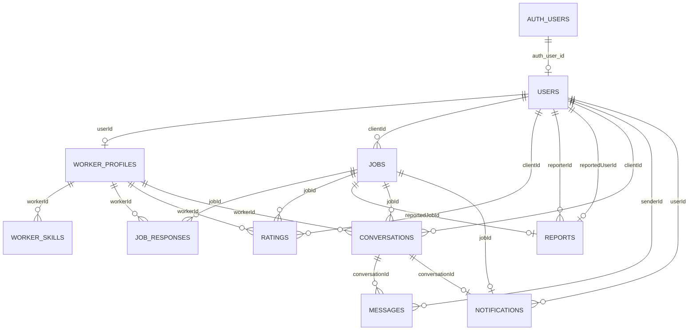

# Data model

The application uses PostgreSQL through Drizzle ORM. [`../drizzle/schema.ts`](../drizzle/schema.ts) provides typed table definitions for queries, while [`../supabase/setup.sql`](../supabase/setup.sql) is the runtime source of truth for constraints, indexes, triggers, RLS, and Storage.

> Important: Drizzle does not declare every constraint. The SQL files add foreign keys, checks, indexes, and cascade behaviour that are not visible in `schema.ts`. Never regenerate the production schema from Drizzle alone.

## Entity relationship overview



## Tables

### `users`

Application-level mirror of a Supabase Auth identity.

| Column | Type | Notes |
|---|---|---|
| `id` | serial PK | Internal numeric user ID used across the app |
| `auth_user_id` | uuid, unique | Supabase `auth.users.id`; FK in SQL with `ON DELETE CASCADE` |
| `name` | text, nullable | From registration metadata |
| `email` | varchar(320), nullable | Case-insensitive unique index in SQL |
| `location` | varchar(255), nullable | User's own location from registration; never defaults to Uasin Gishu |
| `avatar_path` | text, nullable | Private Storage object path |
| `role` | varchar(16), not null | `user`, `client`, `fundi`, or `admin`; default `user`; SQL CHECK enforces the set |
| `createdAt`, `updatedAt` | timestamptz | `updatedAt` trigger in SQL |

Role semantics:

- `user` — registration succeeded but onboarding role has not been chosen.
- `client` — can post jobs and manage owned jobs.
- `fundi` — can maintain a worker profile and express interest.
- `admin` — server-granted only; used for moderation and oversight.

### `worker_profiles`

One profile per fundi user.

| Column | Notes |
|---|---|
| `id` | serial PK; used as `workerId` in responses, ratings, conversations |
| `userId` | unique FK to `users.id`, cascade delete |
| `phone` | optional contact phone |
| `experience` | optional free text |
| `serviceArea` | required; no default. Legacy `Eldoret` default is explicitly dropped in migration `0001` |
| `availability` | `1` available, `0` paused; SQL CHECK enforces 0/1 |
| `latitudeE6`, `longitudeE6` | optional integer E6 coordinates |
| `summary` | optional “about your work” text |
| `createdAt`, `updatedAt` | `updatedAt` trigger in SQL |

### `worker_skills`

A fundi can have multiple trades.

- Unique on `(workerId, trade)`.
- Cascade delete with the worker profile.
- `trade` values come from `PILOT_TRADES`.

### `jobs`

| Column | Notes |
|---|---|
| `id` | `ML-` + 8 uppercase characters |
| `clientId` | FK to `users.id`; owner |
| `title`, `description` | Validated by tRPC |
| `trade` | One of the six pilot trades |
| `locationText` | Manual estate/landmark location |
| `latitudeE6`, `longitudeE6` | Optional approximate coordinates |
| `radiusKm` | Default 10; SQL CHECK `> 0` |
| `budgetAmount` | Integer KSh amount; SQL CHECK `> 0` |
| `startDate` | `YYYY-MM-DD` string |
| `contactPreference` | `Call me`, `Text me`, `Either` |
| `status` | One of seven lifecycle values |
| `createdAt`, `updatedAt` | `updatedAt` trigger in SQL |

### `job_responses`

Represents a fundi's interest in a job.

- Unique on `(jobId, workerId)` — one response per fundi per job.
- `status`: `Interested`, `Accepted`, or `Declined`.
- Cascade deletes with job or worker profile.
- Application adds a second rule: one open response per fundi per start date.

### `ratings`

Job-linked client feedback.

- Unique on `(jobId, clientId)` — one rating per client per job.
- SQL CHECK: `score between 1 and 5`.
- Links job, client, and worker profile.
- `comment` optional.

### `reports`

Moderation records.

- `id`: `R-` + 8 uppercase characters.
- `reporterId`: required.
- `reportedUserId` / `reportedJobId`: optional targets.
- `subjectType`: `Profile`, `Job post`, or `Conduct`.
- `status`: `Review` or `Resolved`.
- `resolvedAt`, `resolvedBy`: set by `admin.resolveReport`.

### `conversations`

Private client–fundi chat threads.

- Unique on `(jobId, workerId)` — one thread per job/fundi pair.
- `clientId` and `workerId` define the two participants.
- Cascade deletes with job or worker profile.
- `updatedAt` changes when a message is sent.

### `messages`

- `conversationId` cascade FK.
- `senderId` FK to `users.id`.
- `body` max 2000 characters.
- `readAt` null until the other participant opens the conversation.

### `notifications`

In-app notification records for the Bell menu.

| Column | Notes |
|---|---|
| `id` | serial PK |
| `userId` | FK to `users.id`, cascade delete |
| `type` | `job`, `interest`, `decision`, `chat`, or `message` |
| `title` | max 160 chars |
| `body` | max 500 chars; `createNotification` truncates |
| `jobId` | FK to jobs in SQL, plain column in Drizzle |
| `conversationId` | FK to conversations in SQL, plain column in Drizzle |
| `readAt` | null until marked read |
| `createdAt` | ordered descending; only latest 50 are returned |

## Indexes defined in SQL

| Index | Columns |
|---|---|
| `jobs_client_created_idx` | `jobs(clientId, createdAt desc)` |
| `jobs_status_trade_idx` | `jobs(status, trade)` |
| `worker_profiles_availability_idx` | `worker_profiles(availability)` |
| `worker_skills_trade_idx` | `worker_skills(trade)` |
| `job_responses_job_idx` | `job_responses(jobId)` |
| `ratings_worker_idx` | `ratings(workerId)` |
| `reports_status_created_idx` | `reports(status, createdAt desc)` |
| `conversations_client_updated_idx` | `conversations(clientId, updatedAt desc)` |
| `conversations_worker_updated_idx` | `conversations(workerId, updatedAt desc)` |
| `messages_conversation_created_idx` | `messages(conversationId, createdAt)` |
| `notifications_user_created_idx` | `notifications(userId, createdAt desc)` |

## SQL-only behaviour

These behaviours exist in SQL but not in Drizzle schema declarations:

- `users.authUserId` foreign key to `auth.users`.
- Role, availability, score, budget, and radius CHECK constraints.
- Notification foreign keys with cascade delete.
- All indexes listed above.
- `integer generated by default as identity` for numeric primary keys, where Drizzle uses `serial`.
- `updatedAt` triggers on `users`, `worker_profiles`, `jobs`, and `conversations`.

Treat `supabase/setup.sql` and the migration files as authoritative for database structure.

## Auth profile synchronisation

`sync_mjengolink_auth_user()` runs after insert or update of `email` or `raw_user_meta_data` on `auth.users`.

On insert it creates a `public.users` row using:

- `new.id` → `auth_user_id`
- `new.email` → `email`
- metadata `name` → `name`
- metadata `location` → `location`
- metadata `role`, when `client`, `fundi`, or `admin` → `role`; otherwise `user`

On conflict it:

- refreshes email, name, and location;
- preserves an existing role unless the new metadata supplies a valid role;
- updates `updatedAt`.

A one-time backfill in `setup.sql` inserts existing `auth.users` rows into `public.users`. On conflict it does **not** overwrite `role`, which protects manually granted admin access.

## Row-level security and privileges

All ten application tables have RLS enabled. The SQL also runs:

```sql
revoke all on table ... from anon, authenticated;
revoke all on all sequences in schema public from anon, authenticated;
alter default privileges in schema public revoke all on tables/sequences from anon, authenticated;
```

No permissive table policies are created. Browsers cannot read application tables directly; all protected access goes through server-side tRPC using `DATABASE_URL`.

Storage **does** use policies, because Storage paths are user-scoped.

## Storage buckets

| Bucket | Private | Size limit | MIME types | Used by app |
|---|---|---|---|---|
| `profile-photos` | yes | 5 MiB | JPEG, PNG, WebP | Yes — profile photo upload/remove |
| `job-attachments` | yes | 15 MiB | JPEG, PNG, WebP, PDF | No — provisioned for future work |

Policies allow `authenticated` users to select, insert, update, and delete objects only when the first path segment equals their Supabase Auth UUID:

```text
<auth-user-uuid>/avatar-1720000000000.png
```

The application uses the service-role client for avatar upload/removal and creates one-hour signed URLs for display.

## Schema files and apply order

| File | Use |
|---|---|
| `supabase/setup.sql` | Canonical full schema for a fresh Supabase project |
| `drizzle/migrations/0001_profile_conversations.sql` | Incremental update for an existing DB: profile columns, conversations, messages, auth sync, updated-at trigger, `profile-photos` bucket |
| `drizzle/migrations/0002_notifications.sql` | Incremental update for an existing DB: notifications table, index, RLS |

Apply order:

```text
Fresh DB:     supabase/setup.sql
Existing DB:  supabase/setup.sql if never applied, then 0001, then 0002
```

`0002` depends on `conversations` from `0001`. Nothing runs automatically at server startup.
