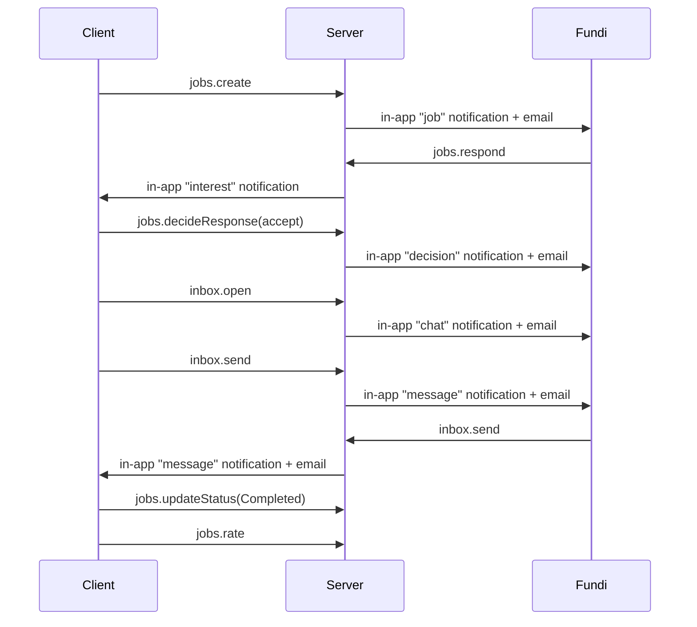

# User workflows

This document describes what users actually see and what the server does underneath. All workflows use real database records; there is no seeded demo data in the rendered app.

## 1. First visit and authentication

### Sign up

1. Open `/`.
2. Choose **Create account**.
3. Enter:
   - full name;
   - your own location, for example `Kapsoya, Eldoret`;
   - `client` or `fundi` role;
   - if fundi, a primary trade and optional phone;
   - email and password, with confirmation.
4. Submit.

Server flow:

- `auth.register` validates input and Brevo configuration.
- Supabase generates a signup confirmation link.
- Brevo delivers the link.
- A `public.users` row is created by the auth sync trigger with the submitted metadata.

The UI switches to sign-in and shows a toast prompting the user to check their inbox, with a **Resend confirmation email** action.

### Confirm email

The link redirects to `/?auth=email-confirmed`. `Home.tsx` shows “Your email is confirmed”, cleans the URL, and leaves the user on the sign-in form.

### Sign in

1. Enter email and password.
2. `auth.login` verifies the account through Supabase.
3. Cookies are set.
4. `auth.me` is invalidated and refetched.

If the email is unconfirmed, the user gets a toast with a resend action.

### Role onboarding

Older accounts may have `users.role = "user"`. The app shows one final step:

- **I need work done** → `client`
- **I offer construction services** → `fundi`

`auth.setRole` refuses to change a role that is already set and never allows self-assignment to admin.

### Forgot and reset password

1. Sign-in screen → **Forgot password?**
2. Enter email. `auth.requestPasswordReset` sends a Brevo email with a Supabase recovery link.
3. Open the link; the app detects `type=recovery` and enters reset mode.
4. Enter and confirm a new password (minimum 8 characters).
5. `auth.updatePassword` applies the new password.
6. Return to sign-in.

Unknown emails return the same neutral success message as known emails.

### Log out

Account panel → **Sign out**:

- `auth.logout` ends the Supabase session and clears cookies.
- React Query cache is cleared.
- The browser is hard-redirected to `/`.

## 2. Client workflow

### Client navigation

| View | Purpose |
|---|---|
| Overview | Metrics, current jobs, fundis in your orbit, pilot pulse |
| My jobs | All owned jobs with review/edit/advance/cancel/rate actions |
| Find fundis | Searchable fundi directory |
| Work history | Completed jobs with feedback entry |

### Post a job

1. Click **Post a job**.
2. Fill in:
   - trade;
   - title;
   - description;
   - estate, landmark, or manual location;
   - proposed pay in KSh;
   - future start date;
   - contact preference.
3. Submit.

Server flow:

- `jobs.create` validates the date and budget.
- It rejects a second non-cancelled job on the same start date.
- It inserts the job as `Posted`.
- It finds matching fundis: available, matching trade, and inside the radius when coordinates exist.
- It creates one in-app `job` notification per matching fundi.
- It sends client confirmation, fundi alert, and admin oversight emails through Brevo.

The client sees a toast such as `Job posted. 4 matching fundis notified.`

### Edit a job

A job can be edited only while `Posted` or `Interested`. The edit form prefills existing values. After saving, the dashboard is invalidated and refreshed.

Assigned, in-progress, completed, and cancelled jobs are read-only with respect to job details.

### Review interest

When a fundi shows interest:

1. The client's Bell shows an `interest` notification.
2. In **My jobs**, the job's **Review** button becomes available.
3. `ResponsesModal` lists each responder with trade, rating, location, experience, and response status.

The client can:

- **Give job** → accept the fundi.
- **Decline** → decline that response.
- **Open chat** → appears after acceptance.

Accepting a response:

- marks all other responses `Declined`;
- marks the chosen response `Accepted`;
- moves the job to `Assigned`;
- notifies the fundi;
- sends an acceptance email.

Declining marks only that response `Declined` and notifies the fundi.

### Open and use chat

Only the client can create a conversation.

1. In the response review modal, click **Open chat** for the accepted fundi.
2. `inbox.open` verifies ownership and the `Accepted` response.
3. A conversation is created or reused.
4. The fundi receives a `chat` notification and email on first creation.
5. Both parties can now send messages through **Chat** in the inbox.

Messages:

- max 2000 characters;
- create a `message` notification for the other participant;
- send an email to the other participant;
- are marked read when the conversation is opened;
- opening also clears related conversation notifications.

### Advance job status

Use **Advance** on a job row. The UI follows the next status in the lifecycle, but the server is authoritative:

```text
Posted → Interested → Accepted → Assigned → In progress → Completed
```

Cancellation is available for non-terminal jobs.

### Rate a completed fundi

1. Once the job is `Completed`, click **Rate fundi**.
2. Choose 1–5 stars.
3. Optionally add a short note.
4. `jobs.rate` links the rating to the accepted fundi, falling back to the latest response for older jobs.
5. One rating per client per job.

Ratings are described in the UI as job-linked experience, not certification.

### Administrative actions available to clients

There is no report-submission form in the current UI, although `jobs.report` exists server-side. The admin reports queue is populated by whatever reports have been inserted through the API/database.

## 3. Fundi workflow

### Fundi navigation

| View | Purpose |
|---|---|
| Kazi board | Searchable and trade-filtered open jobs |
| My responses | Jobs the fundi has shown interest in |
| Work history | Completed jobs the fundi responded to |
| My profile | Persisted trade profile and trust summary |

### Set up the profile

Fundi registration collects a primary trade and phone, but the full profile is completed in **My profile**:

- phone;
- service area;
- trade skills (1–6);
- experience;
- about-your-work summary;
- availability.

`profile.update` upserts `worker_profiles` and replaces all `worker_skills`. The service area is required and no longer has a hard-coded default.

The profile side panel computes a completeness percentage from four real signals: trade, location, note, and experience.

### Availability toggle

Header toggle:

- **Available for kazi** → `availability = 1`
- **Availability paused** → `availability = 0`

Only available fundis are included in new-job matching. The toggle requires an existing fundi profile.

### Browse the kazi board

The fundi sees open jobs from all clients. Filters are client-side over the dashboard payload:

- trade select;
- free-text search over title, location, and trade;
- reset button.

Each opportunity card shows trade, title/ID, location, approximate distance, start date, description, budget, and interest count.

### Show interest

1. Click **Show interest**.
2. `jobs.respond` checks:
   - fundi role;
   - existing profile;
   - job is not Completed or Cancelled;
   - not the fundi's own posting;
   - stored start date is not in the past;
   - no other open response on that start date.
3. A `job_responses` row is inserted as `Interested`.
4. The client receives an `interest` notification.
5. A `Posted` job moves to `Interested`.

The button becomes **Interest sent** for jobs the fundi already responded to. Own postings show **Your posting** instead of “Show interest”.

### After acceptance

The fundi receives:

- a `decision` notification: “You got the job”;
- an acceptance email;
- later, a `chat` notification when the client opens the conversation;
- `message` notifications and emails for each new message.

The fundi cannot open a new chat. The inbox only lists conversations already opened by clients.

### Profile photo

Account panel → choose JPG, PNG, or WebP:

1. The browser reads the file as a data URL.
2. `profile.updatePhoto` decodes it server-side.
3. The image must be ≤5 MiB.
4. It is stored in the private `profile-photos` bucket under the user's Auth UUID.
5. The previous object is removed.
6. `users.avatarPath` is updated and a one-hour signed URL is returned.

**Remove photo** clears both the Storage object and `avatarPath`.

## 4. Admin workflow

### Control room

The admin overview uses database-derived metrics:

- registered users, split by fundi/client;
- jobs posted and open;
- completed jobs;
- open reports;
- profiles with a trade;
- jobs with a clear location;
- completed jobs rated.

All health indicators are ratios from real rows, not fixed percentages.

### Accounts & jobs

Shows up to eight registered accounts with role and status, plus a two-column summary of open jobs, completed jobs, and reports needing review.

### Reports

The reports queue lists subject, ID, reason, date, and Review/Resolved status. **Resolve** calls `admin.resolveReport`, which records status, timestamp, and resolver ID.

There is no separate report-creation form in the current UI.

## 5. Notification centre

The Bell icon is available to all signed-in roles.

- Unread count comes from `notifications.list`.
- The list polls every 10 seconds.
- A Sonner toast appears when the unread count increases.
- The modal offers **Open inbox** and **Mark all read**.
- Clicking a notification marks it read and routes:
  - conversation notifications → the relevant chat;
  - job notifications → Kazi board / overview;
  - client job notifications with responses → the responder review modal;
  - other notifications → the relevant role view.

Notification types:

| Type | Trigger | Recipient |
|---|---|---|
| `job` | New matching job posted | Matching fundis |
| `interest` | Fundi shows interest | Job client |
| `decision` | Client accepts or declines | Fundi |
| `chat` | Client opens conversation | Fundi |
| `message` | Chat message sent | Other participant |

## 6. Cross-role sequence diagram


